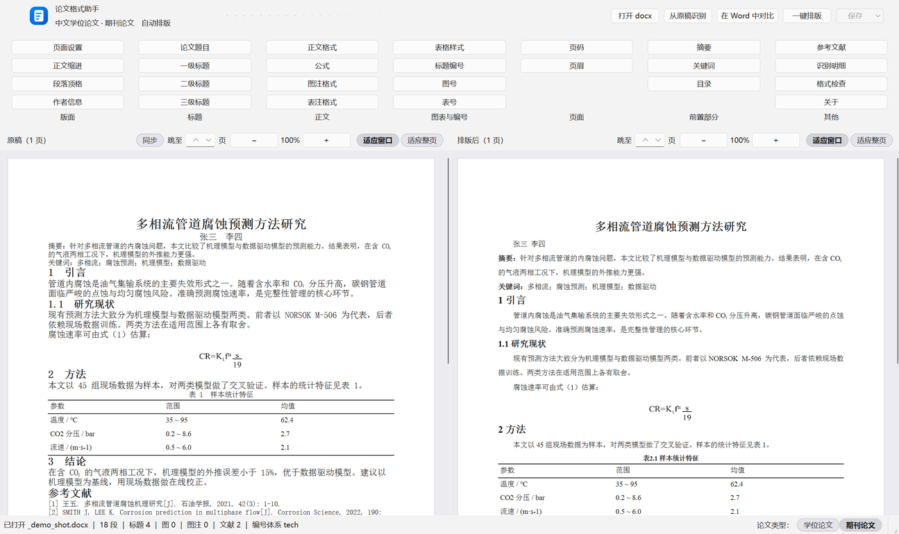
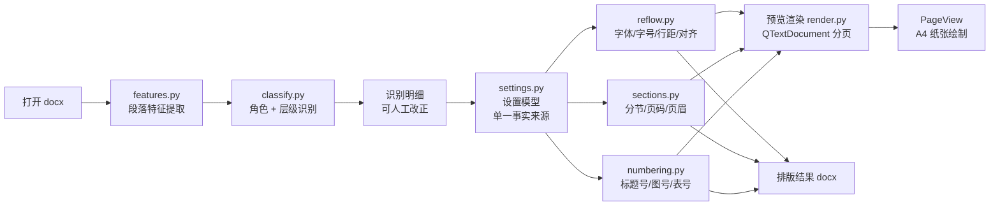

# 论文格式助手

面向**中文学位论文 / 期刊论文**的本地自动排版工具（Windows 桌面程序）。
把一份无格式的 docx 稿子，按学校规范或期刊习惯自动套好版式：字体、字号、行距、
页边距、分节、页码、页眉、图表编号、参考文献格式……**全程本地运行，文档不上传**。

> 通用工具，不绑定任何具体学校。所有规范参数都在界面里，可逐项修改。



---

## 目录

- [功能特性](#功能特性)
- [快速开始](#快速开始)
- [界面与操作](#界面与操作)
- [两种论文形态](#两种论文形态)
- [技术架构](#技术架构)
- [关键技术点](#关键技术点)
- [设置项参考](#设置项参考)
- [常见问题](#常见问题)
- [已知限制](#已知限制)
- [构建与二次开发](#构建与二次开发)
- [免责声明](#免责声明)

---

## 功能特性

- [x] **A4 真分页预览**：纸张边界、页边距、页眉、页码、真实分页，改设置即时重渲染
- [x] **左右双栏对比**：左边原稿、右边排版后，可同步滚动
- [x] **结构自动识别**：题目 / 一级~三级标题 / 摘要 / 关键词 / 目录 / 图表注 / 公式 /
      参考文献 / 尾注区，并给出识别依据与置信度
- [x] **识别明细可人工改正**，改完编号立即重算
- [x] **段落级手动格式**：在预览里点某一段，单独改它的字体 / 字号 / 行距 / 对齐 / 字色，
      或直接把它「设为」某个角色
- [x] **一个按钮 = 一张卡片**：27 张独立设置卡片，每张都带实时绘制的效果示意
- [x] **两种论文形态**：学位论文（三节 + 罗马/阿拉伯页码）、期刊论文（单节 + 阿拉伯页码）
- [x] **页眉可整条开关**，横线的磅宽 / 颜色 / 线型 / 与文字的间距都能调
- [x] **表注 / 图注**：前缀（图 / Fig.）、分隔符、是否按章、起始序号，
      并**自动沿用原稿前缀**（原稿是 `Fig.` 就排 `Fig. 1.1`，不会重复成「图1.1 Fig. 1」）
- [x] **表格样式**：三线表 / 网格 / 无线，线宽、表内中西文字体 / 字号 / 加粗 / 字色 /
      表内对齐 / 表格位置
- [x] **公式**：Word 公式（OMML）与 MathType（OLE/EMF）都能识别；
      MathType 的 EMF 用 GDI+ 超采样转成位图，公式编号（Word 域）一并显示
- [x] **上下标自动识别**：`CO2` / `H2S` / `m2` / `cm3` 自动转成下标 / 上标
      （`Figure 2` / `A4` / `COVID-19` 不会误伤）
- [x] **期刊习惯**：`Abstract:` / `关键词:` 标签自动加粗
- [x] **跳至指定页** + Ctrl 滚轮缩放 + 同步滚动
- [x] **拖拽打开**：把 docx 拖进窗口任意位置直接打开（拖 .doc 会提示先另存为 .docx）
- [x] **格式检查** + 识别明细表

---

## 快速开始

1. 双击 `论文格式助手.exe`（无需安装，单文件夹绿色版）。
2. 点左上角 **打开 docx**，选中你的稿子 —— 双栏预览立刻生成。
3. 右下角切换 **论文类型**（学位论文 / 期刊论文），在 Ribbon 上按需要调整，
   最后点 **一键排版**。
4. 点 **保存 ▾** 选择「覆盖原文件（自动备份 .bak.docx）」或「另存为…」。

> 「一键排版」**只生成结果并刷新预览，不落盘**；是否覆盖原文件由你决定。

---

## 界面与操作

```
标题区    [图标] 论文格式助手 / 中文学位论文 · 期刊论文 自动排版      [打开 docx] [从原稿识别] [在 Word 中对比] [一键排版] [保存 ▾]
Ribbon   版面 | 标题 | 正文 | 图表与编号 | 页面 | 前置部分 | 其他
          （每组最多 4 个按钮，7 个组均分整行宽度，组名固定在卡片底部）
对比区   左：原稿（A4 分页）  │  右：排版后（A4 分页）
         每栏标题行：同步开关 ｜ 跳至 [N] 页 ｜ − 100% ＋ ｜ 适应窗口 ｜ 适应整页
状态栏   文件名 ｜ 段落数 ｜ 页数                                    论文类型：[学位论文][期刊论文]
```

### Ribbon 分组

| 组 | 卡片 |
|---|---|
| 版面 | 页面设置 / 中文缩进 / 段落顶格 / 作者信息 |
| 标题 | 论文题目 / 一级标题 / 二级标题 / 三级标题 |
| 正文 | 正文格式 / 公式 / 图注格式 / 表注格式 |
| 图表与编号 | 表格样式 / 标题编号 / 图号 / 表号 |
| 页面 | 分节（仅学位论文）/ 页码 / 页眉 |
| 前置部分 | 摘要标题 / 摘要正文 / 关键词 / 目录（期刊下目录显示但不可点） |
| 其他 | 参考文献 / 识别明细 / 格式检查 / 关于 |

### 常用操作

| 操作 | 位置 |
|---|---|
| 打开文档 | 左上角「打开 docx」，或**直接把 .docx 拖进窗口任意位置**（拖拽时内容区变淡蓝，松手即开） |
| 同步滚动 | 左栏标题行的「同步」开关 |
| 缩放 | 每栏标题行的 − / ＋ / 适应窗口 / 适应整页，或 **Ctrl + 滚轮** |
| 跳到某页 | 每栏标题行的「跳至 [N] 页」 |
| 单独改某一段 | 在右栏点它 → 弹出浮动格式条 |
| 手工改角色 / 层级 | Ribbon →「识别明细」 |

---

## 两种论文形态

右下角切换，切换会连带换一整套格式预设：

| | 学位论文 | 期刊论文（默认） |
|---|---|---|
| 分节 | 封面 / 前置 / 正文 三节 | 单节 |
| 页码 | 封面无、前置罗马、正文阿拉伯从 1 | 从第 1 页就是阿拉伯 |
| 页眉 | 默认有（可关） | 默认无（可开） |
| 正文 | 12 磅宋体，固定行距 22 磅 | 10.5 磅宋体，固定行距 20 磅 |
| 摘要 / 关键词 | 居中标题，标签不加粗 | **居左**，`Abstract:` / `关键词:` **标签加粗** |
| 目录 | 有 | 卡片显示但**置灰不可点**（鼠标指上去会说明原因） |

---

## 技术架构



### 模块职责

| 模块 | 职责 |
|---|---|
| `detect/features.py` | 段落特征提取：字体、字号、加粗、对齐、行距、首行缩进、表格/图片/公式/OLE、编号前缀、公式编号（Word 域） |
| `detect/classify.py` | 角色识别（题目/标题/摘要/关键词/目录/图表注/公式/参考文献/尾注区）与层级推断 |
| `detect/recognize.py` | 从原稿反读格式（「从原稿识别」按钮） |
| `detect/reflow.py` | 把角色格式写进 docx：四槽位字体、字号、加粗、字色、行距、对齐、表内格式、标签加粗 |
| `detect/sections.py` | 分节、页码格式、页脚页码、页眉（文字 + 横线） |
| `detect/numbering.py` | 标题号 / 图号 / 表号的生成、清洗与写入 |
| `detect/marks.py` | 纯文本里的化学式 / 单位上下标转换 |
| `detect/labels.py` | 段落开头的 `Abstract:` / `关键词:` 标签识别 |
| `detect/emf.py` | 用 GDI+ 把 MathType 的 EMF 转成 PNG（Qt 不支持 EMF） |
| `detect/ui/settings.py` | 设置数据模型（界面、预览、排版共用同一份） |
| `detect/ui/render.py` | 预览渲染：QTextDocument 分页 + 自绘三线表 |
| `detect/ui/pageview.py` | A4 纸张绘制、页眉页码、缩放、跳页、点击定位 |
| `detect/ui/dialogs.py` | 27 张设置卡片 |
| `detect/ui/main_window.py` | 主窗口、Ribbon、双栏对比、跳页、标题区 |

---

## 关键技术点

**1. 用固定行高而不是百分比**
Qt 的 `QTextBlockFormat.setLineHeight(磅值, FixedHeight)` 直接给磅值。
用百分比（`ProportionalHeight`）的基准是字体自然行高，换字体会整体漂移（实测偏大 ~20%）。

**2. 1 布局单位 = 1 磅**
字号统一用 `setPixelSize(pt)`，避免高 DPI 下 Qt 按 96/120dpi 换算导致分页漂移。

**3. 高 DPI 下图片按 devicePixelRatio 折算**
把图片插入 `QTextDocument` 时，如果图源只有 1 像素 = 1 磅，在高 DPI 屏上会被放大 → 发虚。
现在用 `QImage.setDevicePixelRatio()` 把「像素」折算成「磅」，图源保留多倍像素。

**4. `drawContents` 必须给裁剪矩形**
`QTextDocument.drawContents(painter)` 不传矩形 = 画整篇文档。47 页的稿子每滚一步要 115 ms；
传上当页矩形后降到 **7 ms**。

**5. docx 字体必须写四槽位**
`w:ascii` / `w:hAnsi` / `w:eastAsia` / `w:cs` 都要写，并清掉 `*Theme`；
只写 `w:ascii` 或残留主题字体会让中文回退成等线 / Calibri。
中文槽位用中文字体、英文与数字槽位用西文字体。

**6. 遍历所有 `w:r`，包括超链接内部的**
`paragraph.runs` 够不到 `w:hyperlink` / 域内部的 run ——
图注里的 `[1, 3, 4]` 就是这样漏掉的。上/下标的 run 只统一字体族、保留原字号。

**7. 公式行距用「单倍」而不是固定值**
固定 15 磅会把 19 磅高的 OLE 公式压扁（Word 里上下标挤在一起）。

**8. 三线表自绘**
PySide6 的 `QTextTableCellFormat` 的 `TableCell*Border` 属性**不会被画出来**，
所以三线表拆成「表头表 + 数据表」，中间和两端用极矮块画线。
表格位置靠 `QTextFrame` 的左右边距实现（`QTextTable` 没有对齐属性）。

**9. 窗口尺寸按真实缩放比换算**
Qt 报的 dpr 与 Windows 实际缩放可能不一致（Qt 说 1.75、系统按 1.5），
直接乘会把窗口做得比屏幕还大 → 右侧按钮点不到。改用 Win32
`MonitorFromWindow` + `GetMonitorInfoW` 量**窗口所在显示器**的真实可用区。

**10. 公式编号来自 Word 域**
MathType 的编号是 `SEQ MTEqn` 域，文字写在 `w:instrText` 里，`paragraph.text` 读不到。
需要排除域指令后把域外正文和域结果拼起来。

---

## 设置项参考

| 类别 | 可设项 |
|---|---|
| 页面 | 上/下/左/右边距、页眉距、页脚距 |
| 缩进 | 首行缩进字符数、段落顶格 |
| 角色格式 | 字号、中文字体、西文字体、加粗、行距方式（固定值/单倍/1.5 倍/2 倍/最小值）、行距、字色、对齐 |
| 页眉 | 开关、文字、横线磅宽、横线颜色、横线线型（单实/双实/虚线/点线/点划线）、文字与横线间距、中文/西文字体、字号、加粗、字色 |
| 表格 | 样式（三线表/网格/无线）、线宽、表内中文/西文字体、字号、加粗、字色、表内对齐、表格位置 |
| 编号 | 标题编号开关、章号与节号分隔（`1.1`/`1-1`/`11`）、图号/表号前缀、章号与序号分隔、是否按章、起始序号、自动沿用原稿前缀 |
| 页码 | 开关、分节开关、封面/前置/正文页码方案 |
| 其他 | 自动上下标开关、`Abstract:`/`关键词:` 标签加粗、公式行距 |

---

## 常见问题

**Q：预览的分页和 Word 里不一样？**
A：预览按 Qt 自己的字体度量分页，只能当参考。要 100% 真实用「在 Word 中对比」。

**Q：目录页码不对？**
A：目录是 Word 域缓存，需要在 Word 里按 F9 刷新，工具改不了域缓存。

**Q：公式在预览里是图片？**
A：MathType 的 EMF 用 GDI+ 转成位图显示；排版时**原样保留**公式对象，在 Word 里可编辑。

**Q：层级识别错了怎么办？**
A：Ribbon →「识别明细」，逐段查看识别依据并改正；改完预览和编号立即重算。
无样式、无编号的稿子层级只能靠字数/词数/间距推断，准确率有限。

**Q：原稿的图注已经写了 `Fig. 1`，会不会重复？**
A：不会。工具会剥掉原稿前缀再编号，并且默认**沿用原稿前缀**（原稿用 `Fig.` 就排 `Fig. 1.1`）。
在「图号 / 表号」卡片取消勾选「自动沿用原稿前缀」可强制用你设的前缀。

**Q：表格里 `Table 2` 这种表注识别不出来？**
A：现在三种写法都认：`Table 2 …`、`Table  …`（无编号）、`Fig.  (a) …`（分图）。
仍识别不出时用「识别明细」手工改。

---

## 已知限制

1. **分页位置**按 Qt 字体度量，与 Word 不完全一致，只能当参考。
2. **目录页码**需在 Word 里按 F9 刷新。
3. **层级判定准确率**：无编号、无字号差异时约 80%，判错会让后续编号整体错位，
   请在「识别明细」里核对。
4. 只在 **Microsoft Word** 上验证过，WPS 未验证。
5. 原文档若已有 1~2 个节，分节行为未定义。
6. MathType 公式在预览里以**位图**显示（排版结果里仍是公式对象）。

---

## 构建与二次开发

```bash
# 运行界面
.venv/Scripts/python.exe -m detect.ui.app

# 功能自测（三份稿子全过）
QT_QPA_PLATFORM=offscreen .venv/Scripts/python.exe build/selftest.py <docx>

# 打包（PyInstaller，产出 dist/论文格式助手/）
.venv/Scripts/python.exe -m PyInstaller --noconfirm --clean lnpu.spec
```

环境：Python 3.13 / python-docx 1.2 / PySide6 6.12 / pywin32 / Pillow。

```
detect/
├── features.py / classify.py / recognize.py    识别
├── reflow.py / sections.py / numbering.py      排版
├── marks.py / labels.py / emf.py               文本与公式
└── ui/                                         界面（settings 是单一事实来源）
```

---

## 免责声明

本工具只负责**排版**，不负责内容。格式规范请以你所在学校/期刊的最新要求为准；
排版前请备份原文件（「覆盖原文件」会自动生成 `.bak.docx`）。
