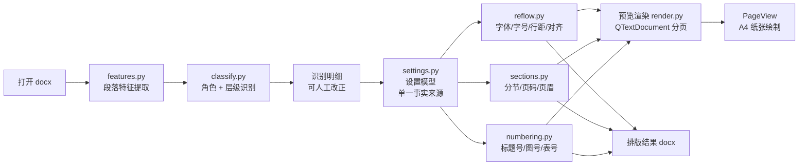

# 论文格式助手

面向**中文学位论文 / 期刊论文**的本地自动排版工具（Windows 桌面程序）。
把一份无格式的 docx 稿子，按学校规范或期刊习惯自动套好版式：字体、字号、行距、
页边距、分节、页码、页眉、图表编号、参考文献格式……**全程本地运行，文档不上传**。

> 通用工具，不绑定任何具体学校。所有规范参数都在界面里，可逐项修改。


---

## 目录

- [功能特性](#功能特性)
- [快速开始](#快速开始)
- [界面与操作](#界面与操作)
- [两种论文形态](#两种论文形态)
- [技术架构](#技术架构)
- [关键技术点](#关键技术点)
- [设置项参考](#设置项参考)
- [常见问题](#常见问题)
- [已知限制](#已知限制)
- [构建与二次开发](#构建与二次开发)
- [版本历史](CHANGELOG.md)
- [免责声明](#免责声明)

---

## 功能特性

- [x] **A4 真分页预览**：纸张边界、页边距、页眉、页码、真实分页，改设置即时重渲染
- [x] **左右双栏对比**：左边原稿、右边排版后，可同步滚动
- [x] **结构自动识别**：题目 / 一级~三级标题 / 摘要 / 关键词 / 目录 / 图表注 / 公式 /
      参考文献 / 尾注区，并给出识别依据与置信度
- [x] **识别明细可人工改正**，改完编号立即重算
- [x] **段落级手动格式**：在预览里点某一段，单独改它的字体 / 字号 / 加粗 /
      行距方式（固定/单倍/1.5 倍/2 倍/最小值）/ 行距 / 对齐 / 字色，或直接把它「设为」某个角色
- [x] **Ctrl 多选批量改**：右栏 Ctrl + 点击选若干段（可跨页），再点其中任意一段，
      改动一次套到全部选中段；Esc 取消选择，改完自动清空
- [x] **一个按钮 = 一张卡片**：独立设置卡片，每张都带实时绘制的效果示意
- [x] **格式方案库**：把一整套设置存成可命名的方案，按「期刊论文 / 学位论文」分组管理；
      内置两套（期刊论文默认 / 学位论文默认）只读；支持**直接把手动调好的全部设置保存为方案**
      （不经过格式识别器）、一键更新当前方案、在「期刊论文 / 学位论文」分类之间移动，
      以及导出 `.json` 发给同门；**记住上次用的方案**（存在 `%APPDATA%\论文格式助手\`，换电脑是空配置）
- [x] **从模板学格式**：拿一份会议模板 / 学校模板当样板，工具读出各角色及**表格内文字**的字体、字号、
      表头/表体独立加粗、行距、对齐、页边距、首行缩进与**真实可见页眉**（自动过滤单页「首页不同」隐藏残留、
      封面残留与纯白隐藏字），**核对表里标清哪些没识别到**并附页眉核对条，确认后存成方案
- [x] **两种论文形态**：学位论文（三节 + 罗马/阿拉伯页码）、期刊论文（单节 + 阿拉伯页码）
- [x] **页眉可整条开关**，横线的磅宽 / 颜色 / 线型 / 与文字的间距都能调；关闭页眉时彻底清除默认/首页/偶数页残留页眉与横线
- [x] **表注 / 图注**：前缀（图 / Fig.）、分隔符、是否按章、起始序号，
      并**自动沿用原稿前缀**（原稿是 `Fig.` 就排 `Fig. 1.1`，不会重复成「图1.1 Fig. 1」）
- [x] **表格样式**：三线表（标准「两粗一细」：顶/底线默认 1.5 磅、栏目线默认 0.75 磅，均可独立调节）/
      网格表 / 无线表，预览与 Word 导出一致；表内中西文字体 / 字号 / **表头与表体独立加粗** / 字色 / 表内对齐 / 表格位置；
      默认**清除原表底纹**（去除蓝色表头等填充色与内置着色表格样式）并**显式清零单元格首行缩进**（避免窄列序号断行）
- [x] **长文档性能优化**：样式索引缓存 + 列表快照 + 原稿侧预览缓存 + 后台线程排版，百页多表长文档打开与一键排版提速 5×~16× 且窗口不假死
- [x] **图片完整渲染**：同时支持现代 DrawingML、老版 `.doc` 转换常见的 VML（如封面校徽/商标）、
      EMF/WMF 矢量图（GDI+ 转 PNG）以及表格单元格内插图
- [x] **公式**：Word 公式（OMML）与 MathType（OLE/EMF）都能识别；
      OMML 按结构自绘（分式 / 根号 / 积分 / 矩阵 / 上下标…），MathType 的 EMF 用 GDI+
      超采样转成位图；**行内公式留在句子里**，显示公式居中、编号右对齐
- [x] **上下标自动识别**：`CO2` / `H2S` / `m2` / `cm3` 自动转成下标 / 上标
      （`Figure 2` / `A4` / `COVID-19` 不会误伤）
- [x] **期刊习惯**：`Abstract:` / `关键词:` 标签自动加粗
- [x] **跳至指定页** + Ctrl 滚轮缩放 + 同步滚动
- [x] **拖拽打开 & 兼容旧版 `.doc`**：把 `.docx` 或 `.doc` 拖进窗口任意位置直接打开
      （`.doc` 自动调用本机 Word 转换为 `.docx` 后载入）
- [x] **格式检查** + 识别明细表

---

## 快速开始

1. 双击 `论文格式助手.exe`（无需安装，单文件夹绿色版）。
2. 点左上角 **打开文档**（或直接把 `.docx` / `.doc` 拖进窗口），双栏预览立刻生成。
3. 右下角 **格式方案** 切换论文形态或已有方案，在 Ribbon 上按需要调整；
   调好后可随时点「格式方案 → 保存当前设置为方案…」存下来复用。
4. 点 **一键排版** 生成排版结果并刷新预览，再点 **保存 ▾** 选择
   「覆盖原文件（自动备份 .bak.docx）」或「另存为…」。

> 「一键排版」**只生成结果并刷新预览，不落盘**；是否覆盖原文件由你决定。

---

## 界面与操作

```
标题区    [图标] 论文格式助手 / 中文学位论文 · 期刊论文 自动排版      [打开文档] [从原稿识别 ▾] [在 Word 中对比] [一键排版] [保存 ▾]
Ribbon   版面 | 标题 | 正文 | 图表与编号 | 页面 | 前置部分 | 方案 | 其他
          （每组最多 4 个按钮，均分整行宽度，组名固定在卡片底部）
对比区   左：原稿（A4 分页）  │  右：排版后（A4 分页）
         每栏标题行：同步开关 ｜ 跳至 [N] 页 ｜ − 100% ＋ ｜ 适应窗口 ｜ 适应整页
状态栏   文件名 ｜ 段落数 ｜ 页数                                    格式方案：[期刊论文默认（内置）]
```

### Ribbon 分组

| 组 | 卡片 |
|---|---|
| 版面 | 页面设置 / 正文缩进 / 段落顶格 / 作者信息 |
| 标题 | 论文题目 / 一级标题 / 二级标题 / 三级标题 |
| 正文 | 正文格式 / 公式 / 图注格式 / 表注格式 |
| 图表与编号 | 表格样式 / 标题编号 / 图号 / 表号 |
| 页面 | 分节（仅学位论文）/ 页码 / 页眉 |
| 前置部分 | 摘要标题 / 摘要正文 / 关键词 / 目录（期刊下目录显示但不可点） |
| 方案 | 格式方案 / 识别明细 |
| 其他 | 参考文献 / 格式检查 / 关于 |

### 常用操作

| 操作 | 位置 |
|---|---|
| 打开文档 | 左上角「打开文档」，或**直接把 `.docx` / `.doc` 拖进窗口任意位置**（拖拽时内容区变淡蓝，松手即开） |
| 同步滚动 | 左栏标题行的「同步」开关 |
| 缩放 | 每栏标题行的 − / ＋ / 适应窗口 / 适应整页，或 **Ctrl + 滚轮** |
| 跳到某页 | 每栏标题行的「跳至 [N] 页」 |
| 单独改某一段 | 在右栏点它 → 弹出浮动格式条 |
| 一次改好几段 | 右栏 **Ctrl + 点击**选中若干段（可跨页），再点其中任意一段 → 改动套到全部选中段；**Esc** 取消选择 |
| 手工改角色 / 层级 | Ribbon →「识别明细」 |
| 套用一套格式方案 | 右下角「格式方案」按钮 → 勾选即用；或 Ribbon →「格式方案」 |
| 保存手动调好的格式方案 | 右下角「格式方案」菜单 / 顶栏「从原稿识别 ▾」→「保存当前设置为方案…」（已在用自定义方案时可一键「更新方案」） |
| 从模板学格式 | 顶栏「从原稿识别 ▾」→「从模板文件识别…」→ 选文件 →「识别」→ 核对 → 保存为方案 |
| 管理 / 改名 / 改分类 / 删除 / 导出方案 | Ribbon →「格式方案」→ 底部按钮（含「保存当前设置…」「移到学位论文 / 期刊论文」） |

---

## 格式方案

「方案」就是**一整套设置**（页面、各角色格式、编号、缩进、页眉、表格样式…），可以命名、勾选、分享。

- **内置两套**：期刊论文默认 / 学位论文默认，只读；按需要手动调好各个卡片后，点
  **「保存当前设置为方案…」** 即可存成自己的方案，支持选归类到「期刊论文」或「学位论文」。
- **状态栏的「格式方案」按钮**：点开是按「期刊论文 / 学位论文」分组的清单，勾选即套用，
  预览和 Ribbon 立刻跟着换；当前在用自定义方案时，菜单里可直接「更新方案」或「另存为新方案」。
- **在期刊与学位之间移类**：在「格式方案」管理面板选中自定义方案，点「移到学位论文 / 移到期刊论文」即可切换归属分类。
- **从模板学格式**：选一份排版好的会议模板 / 学校模板，工具读出每个角色的
  **中文字体、西文字体、字号、加粗、行距、对齐**，以及**页边距**和**首行缩进**，
  在核对表里逐项确认（没识别到的会标「未识别」，不会拿默认值冒充），
  然后「保存方案」或「直接覆盖当前设置」。
- **存哪里**：`%APPDATA%\论文格式助手\schemes\*.json`，一个方案一个文件；
  上次用的方案记在 `%APPDATA%\论文格式助手\settings.json`。
  绿色版拷到别的电脑上是空配置，仍是默认两套，不会把 A 学校的格式带给 B 学校。
- **发给别人**：管理面板 →「导出…」得到一个 `.json`，复制到对方 `%APPDATA%\论文格式助手\schemes\` 目录即可识别。

### 模板导入能学到什么

| 能学 | 学不到（导入后仍用该类型的默认值） |
|---|---|
| 页边距、页眉文字、各角色字体 / 字号 / 加粗 / 行距 / 对齐、首行缩进 | 图号 / 表号前缀与章号分隔、页码方案与分节、表格样式（三线表 / 线宽 / 表内字号） |

还有一种模板是**纯文字写的规范**（如"标题：黑体三号居中"），工具读不了——
那种只能手工在卡片里填。

---

## 两种论文形态

右下角（现在是「格式方案」按钮）切换，切换会连带换一整套格式预设：

| | 学位论文 | 期刊论文（默认） |
|---|---|---|
| 分节 | 封面 / 前置 / 正文 三节 | 单节 |
| 页码 | 封面无、前置罗马、正文阿拉伯从 1 | 从第 1 页就是阿拉伯 |
| 页眉 | 默认有（可关） | 默认无（可开） |
| 正文 | 12 磅宋体，固定行距 22 磅 | 10.5 磅宋体，固定行距 20 磅 |
| 摘要 / 关键词 | 居中标题，标签不加粗 | **居左**，`Abstract:` / `关键词:` **标签加粗** |
| 目录 | 有 | 卡片显示但**置灰不可点**（鼠标指上去会说明原因） |

---

## 技术架构



### 模块职责

| 模块 | 职责 |
|---|---|
| `detect/features.py` | 段落特征提取：字体、字号、加粗、对齐、行距、首行缩进、表格/图片/公式/OLE、编号前缀、公式编号（Word 域） |
| `detect/classify.py` | 角色识别（题目/标题/摘要/关键词/目录/图表注/公式/参考文献/尾注区）与层级推断 |
| `detect/recognize.py` | 从原稿反读格式（「从原稿识别」按钮） |
| `detect/reflow.py` | 把角色格式写进 docx：四槽位字体、字号、加粗、字色、行距、对齐、表内格式、标签加粗 |
| `detect/sections.py` | 分节、页码格式、页脚页码、页眉（文字 + 横线） |
| `detect/numbering.py` | 标题号 / 图号 / 表号的生成、清洗与写入 |
| `detect/marks.py` | 纯文本里的化学式 / 单位上下标转换 |
| `detect/labels.py` | 段落开头的 `Abstract:` / `关键词:` 标签识别 |
| `detect/emf.py` | 用 GDI+ 把 MathType / 插图的 EMF/WMF 转成 PNG（Qt 不支持原生解码） |
| `detect/omml.py` | Word 原生公式（OMML）按结构递归测量与自绘 |
| `detect/schemes.py` | 格式方案库：内置预设、用户方案读写、改名、期刊/学位分类移动与导出 |
| `detect/ui/settings.py` | 设置数据模型（界面、预览、排版共用同一份） |
| `detect/ui/render.py` | 预览渲染：QTextDocument 分页、三线/网格表、DrawingML+VML 图片、行内/显示公式 |
| `detect/ui/pageview.py` | A4 纸张绘制、页眉页码、缩放、跳页、单选/Ctrl 多选定位 |
| `detect/ui/dialogs.py` | 27 张独立设置卡片 + 浮动格式条 + 帮助/关于弹窗 |
| `detect/ui/scheme_dialogs.py` | 格式方案管理、手动保存当前设置为方案、格式识别核对表弹窗 |
| `detect/ui/main_window.py` | 主窗口、Ribbon、双栏对比、跳页、标题区 |

---

## 关键技术点

**1. 用固定行高而不是百分比**
Qt 的 `QTextBlockFormat.setLineHeight(磅值, FixedHeight)` 直接给磅值。
用百分比（`ProportionalHeight`）的基准是字体自然行高，换字体会整体漂移（实测偏大 ~20%）。

**2. 1 布局单位 = 1 磅**
字号统一用 `setPixelSize(pt)`，避免高 DPI 下 Qt 按 96/120dpi 换算导致分页漂移。

**3. 高 DPI 下图片按 devicePixelRatio 折算**
把图片插入 `QTextDocument` 时，如果图源只有 1 像素 = 1 磅，在高 DPI 屏上会被放大 → 发虚。
现在用 `QImage.setDevicePixelRatio()` 把「像素」折算成「磅」，图源保留多倍像素。

**4. `drawContents` 必须给裁剪矩形**
`QTextDocument.drawContents(painter)` 不传矩形 = 画整篇文档。47 页的稿子每滚一步要 115 ms；
传上当页矩形后降到 **7 ms**。

**5. docx 字体必须写四槽位**
`w:ascii` / `w:hAnsi` / `w:eastAsia` / `w:cs` 都要写，并清掉 `*Theme`；
只写 `w:ascii` 或残留主题字体会让中文回退成等线 / Calibri。
中文槽位用中文字体、英文与数字槽位用西文字体。

**6. 遍历所有 `w:r`，包括超链接内部的**
`paragraph.runs` 够不到 `w:hyperlink` / 域内部的 run ——
图注里的 `[1, 3, 4]` 就是这样漏掉的。上/下标的 run 只统一字体族、保留原字号。

**7. 公式行距用「单倍」而不是固定值**
固定 15 磅会把 19 磅高的 OLE 公式压扁（Word 里上下标挤在一起）。

**8. 三线表「两粗一细」与网格表预览**
PySide6 的 `QTextTableCellFormat` 分边边框不绘制，且 `QTextTableFormat.setBorder()`
小于 1.0 会被截成 0。因此三线表拆成「顶线（1.5 磅）+ 表头表 + 栏目线（0.75 磅）+ 数据表 + 底线（1.5 磅）」，
横线用浮点高度 `QTextImageFormat` 绘制以准确呈现粗细比；网格表用 `setBorder(>=1.0)` 画全框线；
Word 导出同步写入 `w:tblBorders`（顶/底 1.5 磅 = 12）与表头 `w:tcBorders/w:bottom`（0.75 磅 = 6）。
表格位置靠外层 `QTextFrame` 的左右边距实现（`QTextTable` 没有对齐属性）。

**9. 窗口尺寸按真实缩放比换算**
Qt 报的 dpr 与 Windows 实际缩放可能不一致（Qt 说 1.75、系统按 1.5），
直接乘会把窗口做得比屏幕还大 → 右侧按钮点不到。改用 Win32
`MonitorFromWindow` + `GetMonitorInfoW` 量**窗口所在显示器**的真实可用区。

**10. 公式编号来自 Word 域**
MathType 的编号是 `SEQ MTEqn` 域，文字写在 `w:instrText` 里，`paragraph.text` 读不到。
需要排除域指令后把域外正文和域结果拼起来。

**11. OMML 自己画**
Qt 画不出 Word 原生公式（OMML 是 XML 结构，不是图片）。`detect/omml.py` 按
`m:f` / `m:sSup` / `m:rad` / `m:nary` / `m:m` … 递归测量、递归绘制到 4 倍分辨率的
`QImage`，再用 `devicePixelRatio` 折算成磅插进预览。

**12. 编号右对齐靠制表位**
Word 里"公式居中 + 编号贴右边距"是**段落制表位**（居中位在栏宽一半、右对齐位在栏宽），
不是空格。排版时给含编号的公式段重写 `w:tabs` 并把段落改成左对齐，编号才真正贴边。

**13. 样式派生的格式要读 docDefaults**
很多稿子（会议模板尤其）把字体/字号只写在 `styles.xml` 的 `docDefaults` 和样式链里，
run 上什么都没有。读取顺序必须是：run → 段落 `pPr/rPr` → 样式链 →
`docDefaults/rPrDefault/rPr`（注意它在 styles.xml，不在 document.xml）。
漏掉这一步，整篇都会"读不出字号"。

**14. 段落字号取"按字符数加权的众数"**
一个段落里可能混着不同字号的 run（一个 14 磅的空格很常见）。取 `max()` 会让整段
变成 14 磅、在预览里像个标题；按字符数加权取众数才是这段真正的字号。

**15. 方案 = 一次 `Settings.to_json()`**
方案库没有引入新的数据结构：`Settings` 本身就能序列化，方案 = 这份 JSON + 名字 + 类型
（期刊/学位）+ 来源文件。存成 `%APPDATA%` 下的一个 `.json`，内置两套不落盘。

**16. 编号"保留已有、只补缺"要对齐计数器**
原稿常常是「1 引言」有号、「1.1 研究现状」没号。保留模式下扫到已有编号就把它解析成
层级数字（`1.2` → `[1, 2]`）灌回计数器，缺号的段落再按当前计数器往下编——
计数器不断档，才不会出现"跳过 7.2 之后前面全乱"的问题。图号/表号同理
（`图3.2` → 第 3 章第 2 图）。

---

## 设置项参考

| 类别 | 可设项 |
|---|---|
| 页面 | 上/下/左/右边距、页眉距、页脚距 |
| 缩进 | 首行缩进字符数、段落顶格 |
| 角色格式 | 字号、中文字体、西文字体、加粗、行距方式（固定值/单倍/1.5 倍/2 倍/最小值）、行距、字色、对齐 |
| 页眉 | 开关、文字、横线磅宽、横线颜色、横线线型（单实/双实/虚线/点线/点划线）、文字与横线间距、中文/西文字体、字号、加粗、字色 |
| 表格 | 样式（三线表/网格/无线）、顶线/底线（外框）粗细（默认 1.5 磅）、栏目线（内线）粗细（默认 0.75 磅）、表内中文/西文字体、字号、加粗、字色、表内对齐、表格位置 |
| 编号 | 标题编号开关、**保留原稿已有编号（只补缺的）/ 全部替换**、章号与节号分隔（`1.1`/`1-1`/`11`）、图号/表号前缀、章号与序号分隔、是否按章、起始序号、自动沿用原稿前缀 |
| 页码 | 开关、分节开关、封面/前置/正文页码方案 |
| 其他 | 自动上下标开关、`Abstract:`/`关键词:` 标签加粗、公式行距 |

---

## 常见问题

**Q：预览的分页和 Word 里不一样？**
A：预览按 Qt 自己的字体度量分页，只能当参考。要 100% 真实用「在 Word 中对比」。

**Q：目录页码不对？**
A：目录是 Word 域缓存，需要在 Word 里按 F9 刷新，工具改不了域缓存。

**Q：公式在预览里是图片？**
A：预览里两种公式都会画成位图：MathType 的 EMF 由 GDI+ 转换，Word 公式（OMML）
由工具自己按结构绘制。排版时**原样保留**公式对象，在 Word 里仍可编辑。

**Q：正文缩进在 Word 里生效吗？**
A：生效。写的是 `w:firstLineChars`（按字符数缩进，换字号也是「2 个字」），
并同时写 `w:firstLine` 兜底；勾「段落顶格」则清掉正文的首行缩进。

**Q：引文编号（`[1]`、`[2]`…）下面有一条横线，是工具加的吗？**
A：不是。这条线来自 EndNote 写进文档的「超链接」字符样式（Hyperlink，带单下划线），
工具全程不改 `w:u`、`w:hyperlink` 和样式表。EndNote 的「下划线链接的文本引文」
只在**格式化那一刻**生效，改设置不会追溯旧引文。在 EndNote 里点
「Update Citations and Bibliography」重新格式化一次即可（引文按当前设置重写）。

**Q：层级识别错了怎么办？**
A：Ribbon →「识别明细」，逐段查看识别依据并改正；改完预览和编号立即重算。
无样式、无编号的稿子层级只能靠字数/词数/间距推断，准确率有限。

**Q：原稿的图注已经写了 `Fig. 1`，会不会重复？**
A：不会。工具会剥掉原稿前缀再编号，并且默认**沿用原稿前缀**（原稿用 `Fig.` 就排 `Fig. 1.1`）。
在「图号 / 表号」卡片取消勾选「自动沿用原稿前缀」可强制用你设的前缀。

**Q：表格里 `Table 2` 这种表注识别不出来？**
A：现在三种写法都认：`Table 2 …`、`Table  …`（无编号）、`Fig.  (a) …`（分图）。
仍识别不出时用「识别明细」手工改。

**Q：从模板学格式，为什么有些值标着「未识别」？**
A：工具只读**文档里真实存在的格式**（run / 样式 / 文档默认值）。模板里没写出来的
（比如通篇没有三级标题），或者写在该类型预设里的项（图号前缀、页码方案、表格样式），
就标「未识别」，套用时沿用当前类型的默认值——不会拿默认值冒充识别结果。

**Q：方案存在哪里？换电脑 / 发给别人怎么办？**
A：`%APPDATA%\论文格式助手\schemes\*.json`。在「格式方案」面板里「导出…」成单个
`.json`，对方放到本机 `%APPDATA%\论文格式助手\schemes\` 目录即可；绿色版目录本身不含方案，拷走不会带走你的设置。

---

## 已知限制

1. **分页位置**按 Qt 字体度量，与 Word 不完全一致，只能当参考。
2. **目录页码**需在 Word 里按 F9 刷新。
3. **层级判定准确率**：无编号、无字号差异时约 80%，判错会让后续编号整体错位，
   请在「识别明细」里核对。
4. 只在 **Microsoft Word** 上验证过，WPS 未验证。
5. 原文档若已有 1~2 个节，分节行为未定义。
6. 公式在预览里以**位图**显示（排版结果里仍是原公式对象，可继续编辑）。
7. 预览里的行内公式会**略高于文字基线**——Qt 的内联图片只能把底边贴在基线上，
   没有垂直偏移量；排版结果（Word 文件）不受影响。
8. **从模板学格式**只认文档里真实写着的格式（run / 样式 / 文档默认值）。
   图号前缀、页码方案、分节、表格样式不在识别范围内；纯文字写的规范说明读不了。

---

## 构建与二次开发

```bash
# 运行界面
.venv/Scripts/python.exe -m detect.ui.app

# 功能自测（三份稿子全过）
QT_QPA_PLATFORM=offscreen .venv/Scripts/python.exe build/selftest.py <docx>

# 打包（PyInstaller，产出 dist/论文格式助手/）
.venv/Scripts/python.exe -m PyInstaller --noconfirm --clean lnpu.spec
```

环境：Python 3.13 / python-docx 1.2 / PySide6 6.12 / pywin32 / Pillow。

```
detect/
├── features.py / classify.py / recognize.py    识别
├── reflow.py / sections.py / numbering.py      排版
├── marks.py / labels.py / emf.py               文本与公式
└── ui/                                         界面（settings 是单一事实来源）
```

---

## 免责声明

本工具只负责**排版**，不负责内容。格式规范请以你所在学校/期刊的最新要求为准；
排版前请备份原文件（「覆盖原文件」会自动生成 `.bak.docx`）。
